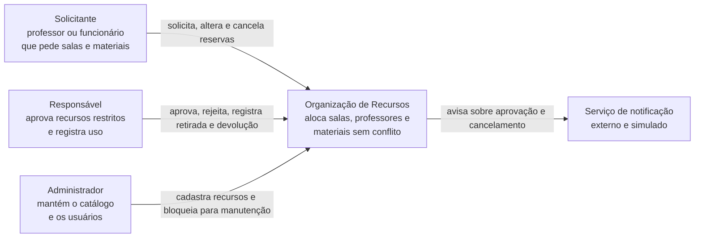
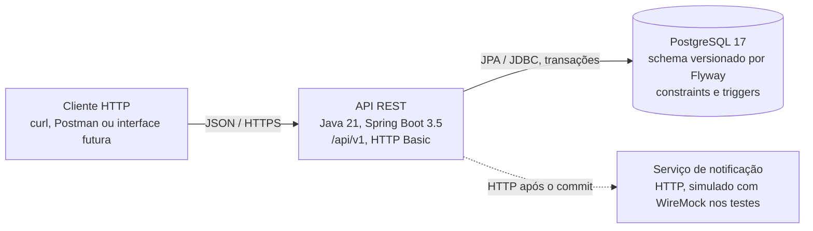
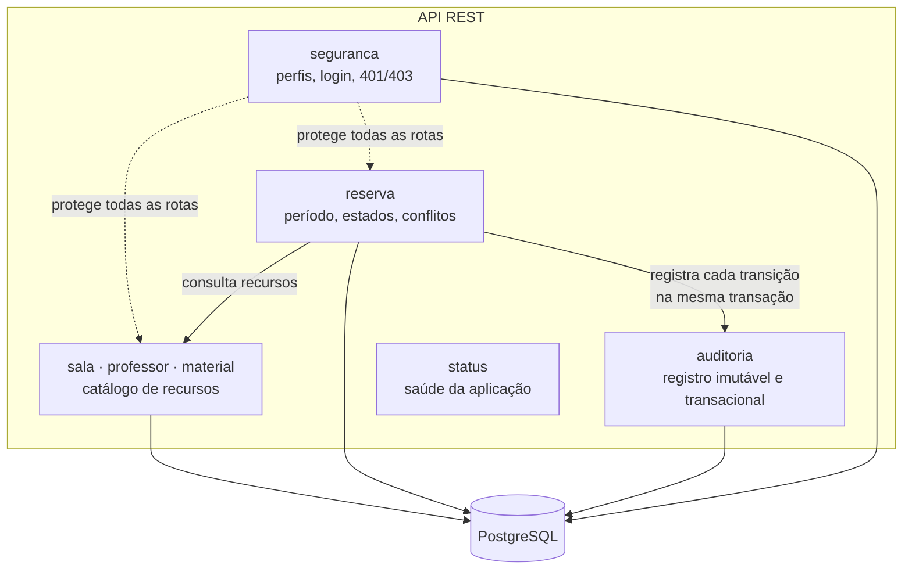

# Modelo C4

Diagramas nos níveis 1 (contexto), 2 (containers) e 3 (componentes da API). A coluna "Situação" indica o que já existe em PR e o que ainda é planejado, para o diagrama não prometer mais do que o código entrega.

## Nível 1 — Contexto

## Nível 2 — Containers

| Container | Responsabilidade | Situação |
|---|---|---|
| API REST | regras de negócio, autorização, auditoria | em construção |
| PostgreSQL | persistência, unicidade, imutabilidade da auditoria e, no RF-06, exclusão de sobreposição | em construção |
| Notificação | aviso ao solicitante (RF-11) | implementado (pacote `notificacao`); disparo pelas reservas no RF-07 |

## Nível 3 — Componentes da API

| Componente | Pacote | Requisitos | Situação | Onde |
|---|---|---|---|---|
| Segurança | `seguranca`, `config` | RF-01, RF-13 | na `main` | PR #3, [ADR 0002](../adr/0002-autenticacao-e-perfis.md) |
| Catálogo | `sala`, `professor`, `material`, `catalogo` | RF-02 | na `main`; RF-03 e RF-08 pendentes | PRs #2 e #5 |
| Reserva | `reserva` | RF-04 a RF-07, RF-09 | parcial: só a validação de período | PR #4 |
| Auditoria | `auditoria` | RF-10 | na `main`; uso nas reservas pendente | PR #6, [ADR 0003](../adr/0003-auditoria-transacional-e-imutavel.md) |
| Status | `status` | saúde da aplicação (não cobre o RF-14, que exige documentação da API) | pronto | `main` |

## Regras de dependência

- Controllers só falam com serviços; regras críticas ficam nos serviços e no banco.
- `auditoria` não depende de nenhum outro módulo; quem muda estado chama a auditoria, nunca o contrário.
- `reserva` depende do catálogo para saber se o recurso existe e está disponível; o catálogo não conhece reservas.
- Integrações externas rodam depois do commit e nunca desfazem a mudança de estado.
