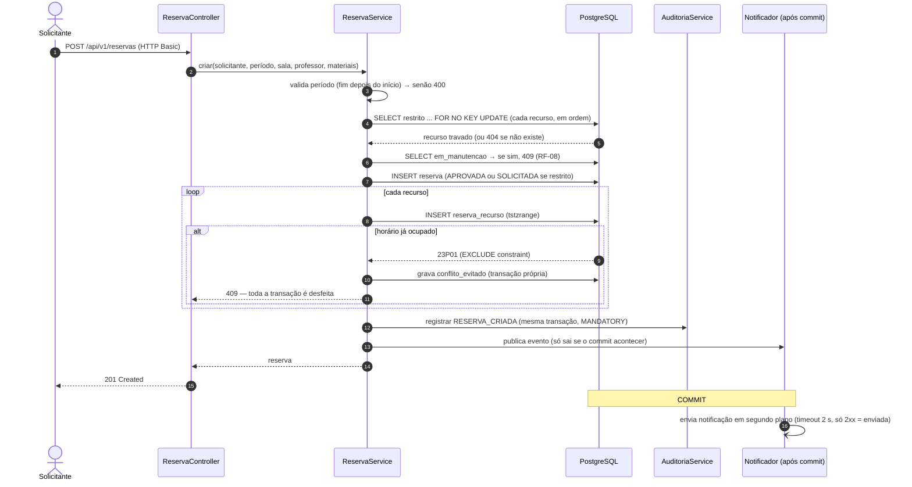

# Sequência crítica — criar reserva (RF-04, RF-05, RF-06, RF-08, RF-11)

É o fluxo com mais risco do sistema: duas pessoas podem pedir o mesmo recurso no mesmo horário. O banco é a última barreira.

## Por que é seguro

- **Travas em ordem fixa** (tipo, depois id): dois pedidos com os mesmos recursos não entram em deadlock.
- **Restrição `EXCLUDE` no banco** (V6): mesmo que dois pedidos passem pela aplicação ao mesmo tempo, só um `INSERT` sobrevive. Provado em `ReservaIntegrationTest` e na [disputa real](../performance/resultado-01.md).
- **Auditoria na mesma transação**: se a auditoria falhar, a reserva não existe.
- **Notificação depois do commit**: um provedor lento ou fora do ar não segura nem desfaz a reserva.
